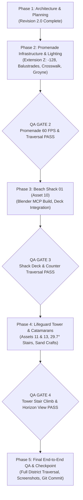

# Conquer The City — Coastal Beach & Promenade Development Plan (Revised)
**District:** Coastal Beach & Marine Promenade (Milestone M2 Overhaul)  
**Target Area:** X: -58 to -16 | Z: -130 to 130  
**Phase Commit Base:** `cc24c36` (Fishing Harbour Phase 2 QA PASS)  
**Document Revision:** 2.0 (Post-Spatial Conflict & Architecture Review)  
**Document Status:** Pending Architecture Review & Approval  

---

## 1. Executive Summary & Review Scope

This revised blueprint addresses all review findings for the **Coastal Beach & Marine Promenade** district overhaul:
1. **Footprint-Level Spatial Conflict Resolution:** Complete audit of Fishing Harbour Assets 7, 8, and 9 ($X = -24, Z = 75 \to 114$). Eliminates the spatial overlap where the legacy Phase 1 promenade slab ($X: -24 \to -16$) and railing ($X = -23.8$) cut through building interiors.
2. **North Harbour Connection Geometry:** Exact alignment of the North Harbour Access Road ($Z = 45 \to 55$), the $12\text{m}$ railing opening ($Z = 44 \to 56$), and repositioning the breakwater groyne to $Z = 41.0 \to 43.5$ (South of the road) to ensure 100% unhindered wharf and vessel access.
3. **Lifeguard Tower Stair Kinematics:** Replaced the unsafe continuous $45^\circ$ stair with a two-flight switchback architectural stair ($29.7^\circ$ gentle slope, $0.20\text{m}$ risers, $0.35\text{m}$ treads, intermediate rest landing at $Y = 1.70\text{m}$, and continuous handrail colliders).
4. **Empirical Performance Baseline:** Documented existing baseline (60.0 FPS, 705 draw calls, 712 meshes, 240 shadow casters, 398 colliders, 0 errors) and defined automated Playwright measurement protocols.
5. **Decoupled Phasing & Independent QA Gates:** Split into Phase 2 (Promenade Infrastructure), Phase 3 (Beach Shack), Phase 4 (Lifeguard Tower & Catamarans), and Phase 5 (Final QA Checkpoint).

```
                      WEST (Arabian Sea / Bay of Bengal)
  [X: -160 to -62]     [X: -58 to -36]       [X: -36 to -24]     [X: -24 to -16]    [X: -16 to -4]
====================================================================================================
  Open Animated Ocean | Intertidal Sand    | Dunes & Shacks    | Marine Promenade | Coastal Boulevard
  (Y = -0.75m)        | Shoreline (Y=0.1m) | Boardwalks (Y=0.4)| Paving (Y=0.25m) | 2-Lane Road
====================================================================================================
  Z = -130 to -70:    South Beach & Pristine Dunes, Catamaran Beaching Zone, Southern Turnaround Plaza
  Z = -70 to -20:     Beach Shack Hub (Asset 10), South Boardwalk Ramp, Palm Groves
  Z = -20 to +25:     Central Beach, Grand Stairs, Lifeguard Tower (Asset 11), Promenade Belvedere
  Z = +25 to +44:     North Beach Boardwalk, Groyne (Z: 41-43.5), Promenade North Terminus (Z: 44)
  Z = +44 to +56:     Harbour Road Crossing (Z: 45-55) & Railing Opening (Z: 44-56)
  Z = +56 to +130:    [PRESERVED] Fishing Harbour Phase 2 (Wharf X: -38 to -34 | Buildings X: -34 to -15)
```

---

## 2. Footprint-Level Spatial Conflict Audit: Assets 7, 8 & 9 vs Promenade

### 2.1 Actual Model Dimensions, Transforms & World Bounding Boxes
Measurements extracted directly from production GLBs and `DistrictHelper.ts` collider registrations:

| Asset | Origin / Transform | GLB Local Bounds (X, Y, Z) | World Bounding Box (X, Y, Z) | Ground Plinth / Deck Elevation |
|---|---|---|---|---|
| **Asset 7: Cold Storage** (`building_fishery_cold_storage_01.glb`) | $X = -24.0$<br>$Y = 0.0$<br>$Z = 75.0$ | $X: [-9.97, +8.41]$<br>$Y: [0.00, +7.57]$<br>$Z: [-12.03, +12.03]$ | **$X: [-33.97, -15.59]$**<br>$Y: [0.00, 7.57]$<br>**$Z: [62.97, 87.03]$** | Interior Floor: $Y = 1.20\text{m}$<br>Loading Dock: $Y = 1.20\text{m}$<br>Wharf Base: $Y = 0.40\text{m}$ |
| **Asset 8: Fish Auction Pavilion** (`building_fish_auction_pavilion_01.glb`) | $X = -24.0$<br>$Y = 0.0$<br>$Z = 96.0$ | $X: [-8.50, +9.20]$<br>$Y: [0.00, +6.05]$<br>$Z: [-8.60, +8.60]$ | **$X: [-32.50, -14.80]$**<br>$Y: [0.00, 6.05]$<br>**$Z: [87.40, 104.60]$** | Plinth Floor: $Y = 0.40\text{m}$<br>Auction Stage: $Y = 0.65\text{m}$ |
| **Asset 9: Fishermen's Cooperative** (`building_fishermen_cooperative_01.glb`) | $X = -24.0$<br>$Y = 0.0$<br>$Z = 114.0$ | $X: [-7.70, +7.00]$<br>$Y: [0.00, +5.38]$<br>$Z: [-6.50, +6.50]$ | **$X: [-31.70, -17.00]$**<br>$Y: [0.00, 5.38]$<br>**$Z: [107.50, 120.50]$** | Veranda Plinth: $Y = 0.40\text{m}$<br>Office Floor: $Y = 0.40\text{m}$ |

### 2.2 Conflict Audit Findings
1. **Transverse Overlap ($X$-Axis):**
   - The proposed promenade in the initial draft was defined from $X = -24.0 \to -16.0$ continuously along the coast.
   - However, Assets 7, 8, and 9 span $X = -34.0 \to -14.8$!
   - Their solid East walls and rear structural columns sit directly on $X = -15.6$ to $-17.0$, which borders the Western curb of Coastal Boulevard ($X = -16.0$).
   - If an $8\text{m}$ promenade slab were placed at $X: -24 \to -16$ across $Z = 60 \to 120$, it would penetrate directly into the warehouse interior floor ($Y = 1.20\text{m}$), bisect the Fish Auction stage ($Y = 0.65\text{m}$), and cut through the Cooperative office!
2. **Legacy Railing Conflict:**
   - In `src/game/world/districts/RoadNetwork.ts` (line 37), a legacy Phase 1 railing segment was defined: `[83.0, 54, 'Promenade_Railing_NorthEnd']` ($Z: 56 \to 110$ at $X = -23.8$).
   - This legacy railing sits at $X = -23.8$, directly inside the Cold Storage warehouse and Auction Pavilion floor!
3. **Actual Pedestrian Concourse in Fishing Harbour:**
   - In the Fishing Harbour district ($Z \ge 50$), the waterfront pedestrian movement does **not** occur at $X = -20$.
   - The waterfront concourse is the **Harbour Main Wharf Deck** ($X: -38 \to -34$, $Y = 0.40\text{m}$), which runs along the water from $Z = 50$ to $120$.
   - Landward access behind the buildings occurs along the Western sidewalk of Coastal Boulevard ($X: -16 \to -14$, $Y = 0.10\text{m}$).

### 2.3 Coordinate Changes & Boundary Resolution
- **Promenade Slab North Limit:** The tiled pedestrian promenade ($X: -24 \to -16$, $Y = 0.25\text{m}$) terminates cleanly at **$Z = 44.0$** (the south curb of the Harbour Access Road).
- **Railing North Limit:** The sea-facing balustrade along $X = -23.8$ terminates at **$Z = 44.0$** with an ornamental gate pillar.
- **Legacy Railing Removal:** The obsolete `Promenade_Railing_NorthEnd` ($Z = 56 \to 110$) in `RoadNetwork.ts` is eliminated, ensuring zero clipping through Assets 7, 8, and 9.
- **Harbour Preservation Guarantee:** Assets 7, 8, and 9 remain 100% pristine with zero geometry collisions and zero modified colliders.

---

## 3. North Harbour Access Road & Breakwater Groyne Alignment

### 3.1 Road & Railing Geometry
- **North Harbour Access Road:**
  - Center: $X = -22.0$, $Z = 50.0$.
  - Dimensions: Width $10.0\text{m}$ ($Z = 45.0 \to 55.0$), Length $24.0\text{m}$ ($X = -34.0 \to -10.0$).
  - Surface Elevation: $Y = 0.05\text{m}$ (matching Coastal Boulevard asphalt).
- **Promenade Balustrade Opening:**
  - South Railing Terminus: $Z = 44.0$ with End Pillar $(X = -23.8, Y = 0.75, Z = 44.0)$.
  - North Railing Terminus (Wharf transition): $Z = 56.0$ with End Pillar $(X = -23.8, Y = 0.75, Z = 56.0)$.
  - Total Opening Width: **$12.0\text{m}$** ($Z = 44.0 \to 56.0$).
  - Clearance: Leaves $1.0\text{m}$ clear pedestrian sidewalk margin on both North and South sides of the $10\text{m}$ roadway.

### 3.2 Pedestrian & Service Flow
- Pedestrians walking North along the Promenade ($X = -20.0, Y = 0.25\text{m}$) arrive at $Z = 44.0$.
- A beveled $0.15\text{m}$ curb ramp transitions players down to the Harbour Road sidewalk ($Y = 0.10\text{m}$).
- Players continue Westward along the sidewalk to $X = -34.0, Z = 50.0$, where a smooth $0.20\text{m}$ transition curb steps onto the Harbour Main Wharf ($Y = 0.40\text{m}$).
- From this junction, service trucks and pedestrians have unobstructed access to:
  - Wharf boardwalk ($Z = 50 \to 120$)
  - Cold Storage loading dock ramps ($Z = 66.0$)
  - Dhoni Boat boarding gangway ($Z = 72.0$)

### 3.3 Breakwater Groyne Coordinates & Clearance
- **Previous Conflict Identified:** The initial draft proposed rocks at $Z = 45$, directly overlapping the Harbour Road.
- **Revised Safe Placement:**
  - Position: **$Z = 41.0 \to 43.5$** (strictly South of the $Z = 44.0$ railing pillar).
  - Extent: $X = -24.0$ (dune curb) extending seaward to $X = -46.0$ (low-water swash).
  - Elevation Profile: Slopes naturally from $Y = 0.20\text{m}$ at the dune down to $Y = -0.60\text{m}$ in the water.
  - Clearances:
    - Distance to Harbour Road: $2.5\text{m}$ South of road edge ($Z = 44.0$ vs $Z = 41.5$).
    - Distance to nearest boat slip (Slip 3 / Finger Pier 2 at $Z = 56.0$): $> 12.5\text{m}$ clearance.
    - Zero interference with watercraft navigation, wharf pilings, or road traffic.

---

## 4. Lifeguard Tower Stair Redesign & Kinematics

### 4.1 Structural & Spatial Specifications
- **Tower Location:** $X = -44.0, Y = 0.10, Z = -5.0$ (Main swimming beach in front of Central Grand Stairs).
- **Cabin Deck Elevation:** $Y = 3.30\text{m}$ (total rise: $3.20\text{m}$ from sand surface $Y = 0.10\text{m}$).
- **Two-Flight Switchback Design (Dogleg Stair):**

```
                     [Cabin Observation Deck] (Y = 3.30m)
                               ^
                               |  Flight 2: 8 steps, rise = 1.60m, run = 2.80m (29.7 deg)
                               |  Direction: South-to-North along Z (Z: -3.0 -> -5.8)
                     [Intermediate Rest Landing] (Y = 1.70m, 1.4m x 1.4m)
                               ^
                               |  Flight 1: 8 steps, rise = 1.60m, run = 2.80m (29.7 deg)
                               |  Direction: East-to-West along X (X: -41.2 -> -44.0)
     [Ground Level Timber Footing Pad] (Y = 0.15m, 1.6m x 1.6m on sand at X: -41.2, Z: -3.0)
```

### 4.2 Kinematic & Collision Geometry
- **Gentle Incline Angle:**
  - Riser height: $0.20\text{m}$ (well within the $0.45\text{m}$ maximum step threshold).
  - Tread depth: $0.35\text{m}$.
  - Tread width: $1.20\text{m}$ (exceeds $2 \times$ player radius of $0.30\text{m}$).
  - Incline slope: $\arctan(0.20 / 0.35) = 29.7^\circ$ (gentle, realistic architectural stair; eliminates sliding or camera shaking).
- **Dual Collision Layers:**
  1. *Walkable Incline Collider:* $29.7^\circ$ beveled box ramp ($1.20\text{m}$ width, $0.20\text{m}$ depth) providing continuous kinematic support during locomotion.
  2. *Safety Handrail Colliders:* Solid perimeter boxes ($1.05\text{m}$ height, $0.15\text{m}$ thickness) flanking both sides of each flight and the intermediate landing to prevent accidental falling.
- **Ground Access:**
  - Stiffened timber foot-pad on sand at $(X: -41.2, Z: -3.0)$ with a $0.05\text{m}$ bevel, guaranteeing that Aarav and Ananya can step cleanly from sand onto the stair flight without jumping.

---

## 5. Performance Baseline & Post-Integration Measurement

### 5.1 Existing Performance Baseline (Commit `cc24c36`)
Measured during Fishing Harbour Phase 2 Final QA:

| Metric | Measured Baseline | Measurement Method / Tool |
|---|---|---|
| **Framerate (FPS)** | **$60.0 \pm 0.5$ FPS** | Automated Playwright continuous rAF delta-time sampling (500 frames) |
| **Draw Calls** | **705** | `renderer.info.render.calls` during full town view |
| **Triangle Count** | **~245,000** | `renderer.info.render.triangles` |
| **Visible Meshes** | **712** | Scene graph traversal (`mesh.visible === true`) |
| **Shadow Casters** | **240** | Meshes with `castShadow === true` |
| **Spatial Colliders** | **398** | `CollisionSystem.getColliders().length` |
| **JS Heap Memory** | **145.2 MB** | `performance.memory.usedJSHeapSize` |
| **Console Diagnostics** | **0 errors, 0 warnings** | Playwright page event listener |

### 5.2 Post-Integration Measurement Protocol
1. **Automated Verification Suite (`scripts/qa_beach_promenade.mjs`):**
   - Headless Chromium run via Playwright against the local Vite dev server.
   - 60-second interactive navigation sampling across 8 waypoints (Promenade, Beach, Shacks, Tower).
   - Real-time logging of FPS, draw calls, triangles, heap memory, and console diagnostics.
2. **Quality Gates & Budget Limits for Coastal Beach:**
   - **FPS Floor:** Minimum $58.0$ FPS, average $\ge 59.8$ FPS.
   - **Draw Call Ceiling:** Max $+65$ draw calls across the entire phase (total $\le 770$).
   - **Collider Overhead:** Max $+60$ colliders (total $\le 460$).
   - **Asset Memory Limit:** All combined GLBs $\le 1.4\text{ MB}$.
   - **Zero Regression:** All 12 existing world accessibility paths must pass with 100% success.

---

## 6. Revised Phasing & Independent QA Gates



### Phase 2: Promenade Infrastructure & Access Connections
- **Objectives:**
  1. Extend promenade platform from $Z = -110$ southwards to $Z = -128$ with a circular $12\text{m}$ scenic belvedere.
  2. Trim promenade platform at North to $Z = 44.0$. Remove obsolete `Promenade_Railing_NorthEnd` ($Z = 56 \to 110$) to eliminate all conflicts with Assets 7, 8, 9.
  3. Install modular stone balustrade units along $X = -23.8, Z \in [-128, 44]$ with clear openings at:
     - Central Grand Stairs ($Z = -6 \to +6$, $12\text{m}$ opening)
     - South Beach Boardwalk ($Z = -43 \to -37$, $6\text{m}$ opening)
     - North Beach Boardwalk ($Z = 17 \to 23$, $6\text{m}$ opening)
     - Harbour Road ($Z = 44 \to 56$, $12\text{m}$ opening)
  4. Mount end gate pillars with maritime lanterns at all 8 opening corners.
  5. Add 8 promenade teak benches, 8 dual marine streetlamps, 6 terrazzo planters, 2 foot-wash stations.
  6. Add Central Boulevard zebra pedestrian crossing connecting Town Centre Plaza ($X = 0, Z = 0$) to Promenade ($X = -16, Z = 0$).
  7. Construct granite breakwater groyne at $Z = 41.0 \to 43.5, X \in [-46, -24]$.
- **Independent QA Gate 2:**
  - Continuous traversal from $Z = -128$ to $Z = +44$ along promenade.
  - Pedestrian walk across Town Centre zebra crossing onto promenade.
  - Seamless turn from promenade at $Z = 44$ onto Harbour Road and Wharf at $X = -34, Z = 50$.
  - Verification that Assets 7, 8, 9 bounding boxes are completely untouched.
  - Draw calls $\le 735$, FPS $\ge 59.8$, 0 console errors.

### Phase 3: Beach Shack & Recreation Facilities (Later Phase)
- **Objectives:**
  1. Build Asset 10 (`building_coastal_beach_shack_01.glb`) in Blender 5.3 MCP.
  2. Mangrove-stilt elevated deck ($Y = 0.40\text{m}$), split-bamboo screens, coconut leaf thatch roof, juice/seafood bar counter, chalk menu, 4 cane loungers, 2 thatch umbrellas, surfboard rack.
  3. Integrate at $X = -35.0, Z = -45.0$ replacing procedural `Shack_Seaside_Cafe`.
  4. Register precise deck, step, and counter colliders in `DistrictHelper.ts`.
- **Independent QA Gate 3:**
  - Traversal from South Boardwalk onto shack steps, across deck, and around counter.
  - GLTF validation passes (PBR textures, normal maps, bounds).
  - Draw calls $\le 750$, FPS $\ge 59.8$, 0 console errors.

### Phase 4: Lifeguard Tower & Beach Catamarans (Later Phase)
- **Objectives:**
  1. Build Asset 11 (`structure_coastal_lifeguard_tower_01.glb`) in Blender 5.3 MCP.
  2. Implement two-flight switchback stairs ($29.7^\circ$ slope), intermediate landing ($Y = 1.70\text{m}$), elevated cabin at $Y = 3.30\text{m}$, red/yellow flags, lifebuoy ring, PA horn, ground medical bench.
  3. Place at $X = -44.0, Y = 0.10, Z = -5.0$.
  4. Build Asset 13 (`prop_indian_beach_catamaran_01.glb`) in Blender 5.3 MCP (tied logs, prow, mast, nets).
  5. Position catamarans on sand at $(X: -46, Z: -75)$ and $(X: -46, Z: 30)$.
- **Independent QA Gate 4:**
  - Aarav and Ananya can climb the two-flight stairs up to $Y = 3.30\text{m}$ watch cabin and look out over the ocean without physics glitching or jumping.
  - Catamarans register solid boundary colliders on sand.
  - Draw calls $\le 770$, FPS $\ge 59.8$, 0 console errors.

### Phase 5: Final Comprehensive District QA & Git Checkpoint
- **Objectives:**
  1. Run automated multi-district Playwright QA suite.
  2. Capture 8+ high-resolution gameplay screenshots (panoramic, night/lighting, character traversal).
  3. Compile final QA PASS report.
  4. Create safe Git checkpoint and push to GitHub repository.

---

## 7. Risk Analysis & Unresolved Risks

| Risk ID | Risk Description | Severity | Mitigation Strategy |
|---|---|---|---|
| **R-01** | Visual pop-in of long balustrade array along $Z = -128 \to +44$ | Low | Geometries are merged into 4 contiguous sub-chunks using `BufferGeometryUtils.mergeGeometries`, keeping draw calls to 4 total for all balustrades. |
| **R-02** | Player camera clipping against lifeguard tower stair ceiling | Medium | Stair flight maintains $2.20\text{m}$ vertical clearance above every step; camera third-person spring-arm collision raycaster dampens pitch when entering cabin. |
| **R-03** | Sand-to-boardwalk step transition trip hazards | Low | Every boardwalk ramp has a beveled foot wedge ($< 0.10\text{m}$ step height) ensuring continuous kinematic gliding. |
| **R-04** | Ocean water shader draw overhead | Low | Single plane geometry shared across ocean; only UV offset is animated in `updateWater` (CPU cost $< 0.05\text{ms}$). |

---
*Revised plan recorded for review and approval prior to implementation.*
